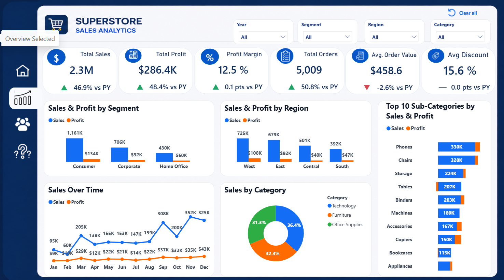
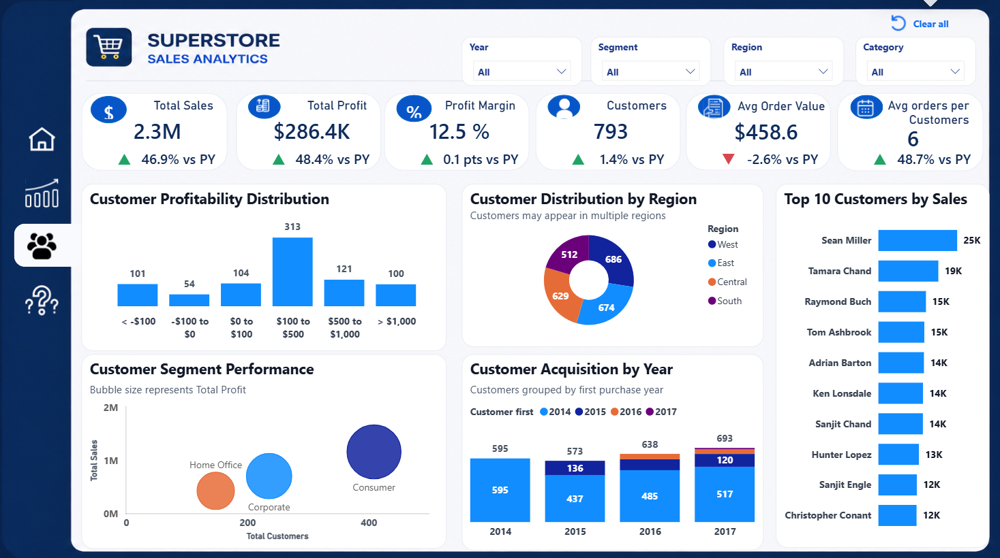

Superstore | Sales & Profitability Analysis
Power BI · DAX · Power Query · Data Modeling · Business Analytics

[Dashboard walkthrough](Superstore.mp4) · [Sales overview](Overview.png) · [Customer analysis](Customers.png) · [What-If simulation](What%20if.png)
Business challenge
Sales growth does not always mean stronger profitability. This project explores where revenue and profit come from, which regions need attention, and how commercial decisions might change financial outcomes.

The objective is to turn transactional sales data into clear, decision-oriented insights for business stakeholders.
Executive snapshot
KPI	Dashboard result
Total sales	$2.3M
Total profit	$286.4K
Profit margin	12.5%
Orders	5,009
Average order value	$458.6
Average discount	15.6%

Figures are displayed as shown in the dashboard with filters set to All.

Key business findings
1. West leads in sales and profit
The West region records $725K in sales and $108K in profit, the highest values among the four regions displayed.

Business implication: Explore the product mix and customer patterns behind West's performance to identify practices worth testing elsewhere.
2. Central needs a profitability review
Central generates $501K in sales but only $40K in profit. Based on the rounded values displayed, its profit margin is approximately 8%, below West's approximately 14.9%.

Business implication: Investigate discounts, product categories and cost drivers before deciding on corrective action.
3. Growth is accompanied by a lower order value
Year-over-year sales increased 46.9%, profit increased 48.4%, and orders increased 50.8%, while average order value decreased 2.6%.

Business implication: Examine whether growth is being driven primarily by more frequent or smaller orders and how this affects commercial strategy.
Customer analytics
The customer view supports analysis of customer and segment performance to help identify where revenue and profitability are concentrated.

What-If: testing commercial decisions
The dashboard includes a DAX-based scenario tool for exploring the combined effect of pricing, quantity and discount assumptions.
Scenario input	Selected change
Price	+25%
Quantity	-5%
Discount	+2 percentage points

Simulated outcome	Dashboard result
Sales impact	+$362.7K (+15.8%)
Profit impact	+$463.2K (+161.7%)
Profit margin impact	+15.7 percentage points (+126.1% relative)

Interpretation: Under these specific assumptions, the model indicates higher simulated sales and profit despite lower quantity. These are hypothetical model outputs, not realized gains or validated forecasts. The profit calculation assumes historical implied costs change proportionally with quantity; the model does not estimate customer price elasticity or separate fixed and variable costs.
Analytical approach
1. Data preparation: Power Query transformations to prepare the sales data for reporting.
2. Data modeling: Structured model to support analysis by region, segment, category and time.
3. KPI development: DAX measures for sales, profit, margin, orders, year-over-year comparisons and scenario outputs.
4. Exploration: Interactive views for sales performance, customers and commercial scenarios.
5. Business interpretation: Identification of profitability gaps and decision-oriented follow-up questions.
Recommendations to investigate
- Review Central's discounting, product mix and cost structure to understand its lower margin.
- Examine West's strongest-performing segments and products for transferable practices.
- Monitor average order value alongside order growth, rather than relying on sales growth alone.
- Use What-If as a sensitivity-testing aid, followed by commercial validation before acting.
Portfolio scope
This repository showcases the analysis through screenshots and a video demonstration. The Power BI .pbix file is intentionally not published.

Author: Zahra Oumous
Focus: Data Analytics · Business Intelligence · Power BI · SQL · Python
